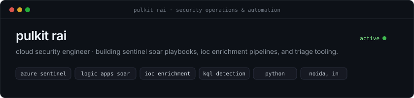

  

 

### what i do.
cloud security and soc automation engineer based in noida, india. i build microsoft sentinel soar playbooks, threat enrichment pipelines, and response tooling that take repetitive triage off analyst plates.

### selected work.
- **[ioc-enrichment](https://github.com/pulkitrais/ioc-enrichment-logic-app-azure)**
  sentinel incident enrichment playbook using azure logic apps, virustotal v3, key vault secrets, and azure table storage caching.
- **[sentinel-soar-lab](https://github.com/pulkitrais/Azure-Sentinel-SOAR-Lab-Brute-Force-Detection-and-Automated-Email-Response)**
  brute-force detection pipeline with automated analyst email alerting and containment response.
- **[soc-notes](https://github.com/pulkitrais/soc-notes)**
  detection engineering playbooks, triage flows, and kql queries for security operations.

### stack.
- **siem & cloud** · microsoft sentinel, defender for cloud, entra id, linux
- **automation** · azure logic apps, soar playbooks, rest apis, webhooks
- **detection & dev** · kql, python, bash, json

### connect.
[portfolio](https://pulkitrai.tech) · [github](https://github.com/pulkitrais) · [email](mailto:pulkitonwork@gmail.com)
